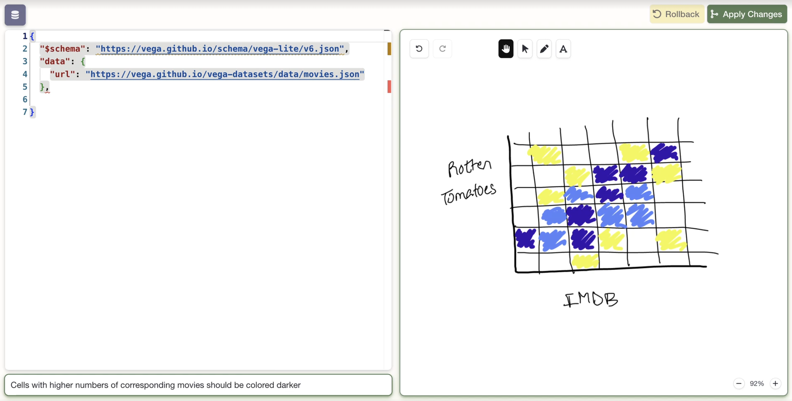

# Inkling

**Inkling** is a multimodal visualization authoring tool developed at Cal Poly San Luis Obispo.
It integrates code editing, chat instructions, and hand-drawn sketching, allowing a user to move between or combine these modalities to create or refine data visualizations.

It is a [SvelteKit](https://svelte.dev/docs/kit) web app.
A user edits a [Vega-Lite](https://vega.github.io/vega-lite/) spec in a code editor, sketches or annotates on a canvas, and/or types instructions in a chat box.
When they click **Apply Changes**, the server sends those inputs to Claude (Anthropic's language model), which returns an updated spec.

We implemented a prototype and ran a short pilot study with visualization novices (presented at EduVIS 2026):

- [INKLING: Exploring How Students Design Visualizations with Integrated Sketching, Natural Language, and Code Editing](https://ayaankazerouni.org/papers/2026/eduvis2026inkling.pdf). Sadie M. Fisher, Austin P. Wright, Ayaan M. Kazerouni.

To set up the project, run it locally, or contribute, see [CONTRIBUTING.md](CONTRIBUTING.md).
